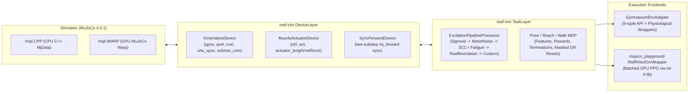

# myosuite-reaf

**MyoSuite musculoskeletal environments authored on Google DeepMind's [`reaf-sim`](https://github.com/google-deepmind/reaf-sim) and [`mujoco_playground`](https://github.com/google-deepmind/mujoco_playground) (PyTorch + MuJoCo 4 + MuJoCo Warp 4).**

`myosuite-reaf` is a standalone prototype and dogfooding suite that brings [MyoSuite](https://github.com/MyoHub/myosuite)'s Hill-type muscle biomechanics, physiological excitation pipeline, and cross-backend Gymnasium contract onto Google DeepMind's PyTorch Robotics Environment Authoring Framework (`reaf-sim` >= 1.0.1) and MuJoCo 4 (`mujoco` >= 4.0.1, `mujoco-warp` >= 4.0.1).

It is engineered with two goals:
1. **Stress-test `reaf-sim`, `mujoco_playground`, and MuJoCo 4** on stiff over-actuated musculoskeletal systems (up to 216 muscles, spatial cylinder/sphere tendon wrapping, polynomial `JointCouplings`, passive exosuits with multiple unnamed `<freejoint/>`s and `<weld>` constraints, and stateful 3-compartment muscle fatigue). See [`DOGFOODING_REPORT.md`](DOGFOODING_REPORT.md) for all **14 empirical upstream findings** and proposed patches.
2. **Prototype a unified CPU + GPU backend (`myosuite/envs/myo/backends/reaf/`)** for direct integration into MyoSuite once MyoSuite migrates its dependency floor from MuJoCo 3.x to MuJoCo 4.x.

---

## Architecture

Unlike split NumPy-CPU / PyTorch-GPU architectures, `myosuite-reaf` authors each anatomical model, observation, reward, termination, and muscle excitation stage **once** in PyTorch over `reaf.simulation.torch`:



### Key Primitives Implemented

- **[`MuscleActuatorDevice`](src/myosuite_reaf/devices/muscle_actuator_device.py):** Extends `reaf-sim`'s `DeviceLayer` with Hill-type muscle activation reads (`act`), tendon/muscle kinematics (`actuator_length`, `actuator_velocity`, `actuator_force`), hybrid muscle + motor indexing via `actuator_actadr`, uniform `float32` tensor views across `Impl.CPP` and `Impl.WARP`, and masked `set_act()` puppet resets.
- **[`KinematicsDevice`](src/myosuite_reaf/devices/kinematics_device.py):** Exposes generalized coordinates (`qpos`, `qvel`), body twist (`cvel`), world-frame site positions (`site_xpos`), CoM (`subtree_com`), and torso orientation (`xmat`) while supporting unnamed `<freejoint/>` elements and coupled joints cleanly.
- **[`SyncForwardDevice`](src/myosuite_reaf/devices/sync_forward_device.py):** Runs `sim.forward()` on the final physics substep before `DeviceLayer` collects measurements, eliminating the 1-substep kinematic/force lag on derived quantities (`site_xpos`, `cvel`, `actuator_force`).
- **[`ExcitationPipelineProcessor`](src/myosuite_reaf/processors/excitation_pipeline.py):** Vectorized PyTorch command processor implementing MyoSuite's canonical muscle pipeline across `(nworld, nu)` worlds:
  1. Optional normalized action `[-1, 1] -> [0, 1]` logistic sigmoid (`sigmoid_excitation`).
  2. Signal-dependent + constant Gaussian motor noise (`van Beers et al., 2004`).
  3. 3-compartment (3CC-r) cumulative muscle fatigue (`myo_sim.fatigue.TorchFatigueState`).
  4. Tendon-transfer reafferentation (`EIP -> EPL` excitation rerouting).
  5. Arbitrary user-authored `ExcitationStage` plugins (e.g., `LowPassStage`, spasticity, FES).
- **[`GymnasiumEnvAdapter`](src/myosuite_reaf/wrappers/gymnasium_adapter.py):** Enforces MyoSuite's five cross-backend contract invariants (`Box(-inf, inf, float32)` observations, `obs_dict` / `rwd_dict` info keys, `dt == frame_skip * sim_dt`, exact step-count truncation, and deterministic per-seed resets) plus drop-in `MotorNoiseWrapper`, `FatigueWrapper`, `SarcopeniaWrapper`, `ReafferentationWrapper`, `ExcitationStageWrapper`, and `DictObservationWrapper`.

---

## Installation

Requires **Python 3.12 or 3.13** and [`uv`](https://docs.astral.sh/uv/).

> **Note on `myo-sim` metadata:** `myo-sim==0.2.5` currently declares `mujoco>=3.4,<4` in its wheel metadata while `reaf-sim>=1.0.1` requires `mujoco[sysid]>=4.0.0`. [`pyproject.toml`](pyproject.toml) configures `[tool.uv] override-dependencies = ["mujoco[sysid]>=4.0.0"]` automatically so `uv` resolves MuJoCo 4 cleanly.

### Linux / Windows with NVIDIA CUDA GPU (Recommended)

```bash
git clone https://github.com/M-Colley/myosuite-reaf.git
cd myosuite-reaf

uv venv --python 3.13
# Install CUDA-enabled PyTorch first (adjust cu128 / cu132 for your driver), then myosuite-reaf:
uv pip install torch torchvision --index-url https://download.pytorch.org/whl/cu132
uv pip install -e ".[dev]"
```

### CPU-Only (Linux / macOS / Windows)

```bash
uv venv --python 3.13
uv pip install -e ".[dev]"
```

---

## Quickstart

### 1. MyoSuite `make_env` Gymnasium API (CPU or Single-World GPU)

```python
import numpy as np
from myosuite_reaf import make_env

# Run on MuJoCo 4 C++ CPU ("cpp") or MuJoCo Warp GPU ("warp") with identical code:
env = make_env("myoHandReachRandom-v0", impl="cpp", seed=42)
obs, info = env.reset(seed=42)

for _ in range(20):
    action = np.zeros(env.action_space.shape, dtype=np.float32)
    obs, reward, terminated, truncated, info = env.step(action)
    if terminated or truncated:
        obs, info = env.reset()

print("obs shape:", obs.shape, "tip_pos:", info["obs_dict"]["tip_pos"].shape)
env.close()
```

### 2. Physiological Wrappers & Custom `ExcitationStage` Plugins

```python
from myosuite_reaf import (
    ExcitationStageWrapper,
    FatigueWrapper,
    LowPassStage,
    MotorNoiseWrapper,
    ReafferentationWrapper,
    SarcopeniaWrapper,
    make_env,
)

env = make_env("myoHandPoseFixed-v0", impl="cpp", seed=0)
env = SarcopeniaWrapper(env, force_scale=0.5)              # 50% peak muscle strength reduction
env = MotorNoiseWrapper(env, {"k_sd": 0.103, "k_const": 0.018})
env = FatigueWrapper(env, fatigue_reset_random=False)      # 3CC-r active/fatigued/resting pools
env = ReafferentationWrapper(env, "EIP_r", "EPL_r")        # Tendon-transfer rerouting
env = ExcitationStageWrapper(env, lambda: LowPassStage(alpha=0.3))

obs, info = env.reset(seed=0)
obs, reward, terminated, truncated, info = env.step(env.action_space.sample())
env.close()
```

### 3. Native Batched `reaf-sim` GPU Execution (4,096 Parallel Worlds)

```python
import torch
from myosuite_reaf import EnvConfig, FatigueSpec, SarcopeniaSpec, make_reaf_env

reaf_env = make_reaf_env(
    "myoLegWalk-v0",
    config=EnvConfig(
        impl="warp",
        num_envs=4096,
        device="cuda:0",
        seed=0,
        features=(SarcopeniaSpec(0.75), FatigueSpec()),
    ),
)

ts = reaf_env.reset()
actions = torch.zeros((4096, 80), device="cuda:0", dtype=torch.float32)
ts = reaf_env.step({"actions": actions})
print("Batched policy obs:", ts.observation["policy"].shape)  # (4096, 403)
reaf_env.close()
```

### 4. `mujoco_playground` + `rsl-rl-lib` GPU PPO Training

All 59 environments register directly into `mujoco_playground`'s `env_registry` via `register_with_playground()`:

```bash
# Train a 512-world GPU PPO policy on 1D 6-muscle elbow pose tracking:
python scripts/train_rsl_rl.py --env myoElbowPose1D6MRandom-v0 --num-envs 512 --iterations 50

# Train on 39-muscle dexterous 5-finger hand reaching:
python scripts/train_rsl_rl.py --env myoHandReachRandom-v0 --num-envs 2048 --iterations 300
```

---

## Registered Environments (21 Base Tasks / 59 Total Variants)

Every `myo*` task automatically registers **Sarcopenia** (`myoSarc*`, 50% force scale) and **3CC-r Fatigue** (`myoFati*`) variants, and every `myoHand*` task additionally registers a **Reafferentation** (`myoReaf*`, `EIP -> EPL`) variant, totaling **59 registered environments**:

| Environment ID | Anatomy & Actuation | `nq` | `nv` | `nu` | `na` | `obs` | `frame_skip` | `max_steps` | Physiological Variants |
| :--- | :--- | ---: | ---: | ---: | ---: | ---: | ---: | ---: | :--- |
| `motorFingerPose{Fixed,Random}-v0` | 4-DoF index finger (5 torque motors) | 4 | 4 | 5 | 0 | 12 | 5 | 200 | — |
| `motorFingerReach{Fixed,Random}-v0` | 4-DoF index finger 3D reach (5 motors) | 4 | 4 | 5 | 0 | 14 | 5 | 200 | — |
| `myoElbowPose1D6M{Fixed,Random}-v0` | 1-DoF elbow (6 Hill-type muscles) | 1 | 1 | 6 | 6 | 9 | 10 | 100 | `myoSarc*`, `myoFati*` |
| `myoElbowPose1D6MExo{Fixed,Random}-v0` | Hybrid 6 muscles + 1 exo motor + payload DR | 1 | 1 | 7 | 6 | 9 | 10 | 100 | `myoSarc*`, `myoFati*` |
| `myoFingerPose{Fixed,Random}-v0` | 4-DoF index finger (5 muscles) | 4 | 4 | 5 | 5 | 17 | 10 | 100 | `myoSarc*`, `myoFati*` |
| `myoFingerReach{Fixed,Random}-v0` | 4-DoF index finger 3D reach (5 muscles) | 4 | 4 | 5 | 5 | 19 | 10 | 100 | `myoSarc*`, `myoFati*` |
| `myoHandPose{Fixed,Random}-v0` | 23-DoF dexterous hand (39 muscles, ASL poses) | 23 | 23 | 39 | 39 | 108 | 10 | 100 | `myoSarc*`, `myoFati*`, `myoReaf*` |
| `myoHandReach{Fixed,Random}-v0` | 23-DoF 5-fingertip 3D reach (39 muscles) | 23 | 23 | 39 | 39 | 115 | 10 | 100 | `myoSarc*`, `myoFati*`, `myoReaf*` |
| `myoArmReach{Fixed,Random}-v0` | 18-DoF shoulder+elbow+wrist `IFtip` reach (50 muscles) | 18 | 18 | 50 | 50 | 92 | 10 | 150 | `myoSarc*`, `myoFati*` |
| `myoTorsoPoseFixed-v0` | 18-DoF articulated lumbar/thoracic spine (216 muscles) | 18 | 18 | 216 | 216 | 270 | 5 | 200 | `myoSarc*`, `myoFati*` |
| `myoTorsoExoPoseFixed-v0` | 216-muscle spine + passive exosuit (2 freejoints + 2 welds) | 32 | 30 | 216 | 216 | 296 | 5 | 200 | `myoSarc*`, `myoFati*` |
| `myoLegWalk-v0` | 34-DoF floating-base bipedal locomotion (80 muscles) | 35 | 34 | 80 | 80 | 403 | 10 | 1000 | `myoSarc*`, `myoFati*` |

---

## Empirical Validation

### MuJoCo 4.0.1 CPU (`impl="cpp"`, float64) vs GPU Warp (`impl="warp"`, float32) Parity

Verified across 9 anatomical & actuation families over 10 control steps (`100` physics substeps, `nworld=8` parallel GPU worlds vs CPU reference) in [`tests/test_cpu_warp_parity.py`](tests/test_cpu_warp_parity.py):

| Environment | `max \|Δqpos\|` | `max \|Δact\|` | `max \|Δobs\|` | `max \|Δrwd\|` | Inter-World GPU `Δqpos` |
| :--- | ---: | ---: | ---: | ---: | ---: |
| `myoElbowPose1D6MRandom-v0` | `1.48e-06` | `5.50e-08` | `1.43e-06` | `1.91e-06` | `1.19e-07` |
| `myoElbowPose1D6MExoRandom-v0` | `2.56e-07` | `7.59e-08` | `2.38e-07` | `3.58e-07` | `0.00e+00` |
| `myoFingerPoseRandom-v0` | `6.59e-06` | `8.45e-08` | `6.59e-06` | `5.72e-06` | `5.96e-07` |
| `motorFingerReachRandom-v0` | `8.31e-07` | `0.00e+00` | `8.34e-07` | `1.64e-07` | `3.73e-09` |
| `myoHandPoseRandom-v0` | `1.40e-06` | `8.69e-08` | `2.16e-06` | `9.54e-07` | `1.43e-06` |
| `myoHandReachRandom-v0` | `1.51e-06` | `8.69e-08` | `1.49e-06` | `2.24e-07` | `2.74e-06` |
| `myoArmReachFixed-v0` | `4.23e-06` | `1.28e-07` | `5.12e-06` | `5.36e-07` | `9.62e-06` |
| `myoTorsoExoPoseFixed-v0` | `4.40e-07` | `1.45e-07` | `4.40e-07` | `0.00e+00` | `1.19e-07` |
| `myoLegWalk-v0` | `1.88e-05` | `1.91e-07` | `5.46e-05` | `4.36e-05` | `9.54e-07` |

### Throughput Scaling (`NVIDIA GeForce RTX 4070 Ti SUPER` 16 GiB, `substeps=10`)

Measured end-to-end through the full `reaf-sim` `Environment.step()` loop (including `ExcitationPipelineProcessor`, `SyncForwardDevice`, observation assembly, rewards, and auto-resets) via [`scripts/benchmark_throughput.py`](scripts/benchmark_throughput.py):

| Environment (`DoF / Muscles`) | CPU C++ (`1` env) | Warp (`1`) | Warp (`64`) | Warp (`512`) | Warp (`2048`) | Warp (`4096` envs) | Peak Physics Substeps/s | GPU Speedup vs CPU |
| :--- | ---: | ---: | ---: | ---: | ---: | ---: | ---: | ---: |
| `myoElbowPose1D6MRandom-v0` (`1 / 6`) | 1,394 | 248 | 16,404 | 121,216 | 404,165 | **609,097** | **6.09M / s** | **437x** |
| `myoHandReachRandom-v0` (`23 / 39`) | 914 | 200 | 10,542 | 53,796 | 127,534 | **163,271** | **1.63M / s** | **179x** |
| `myoArmReachFixed-v0` (`18 / 50`) | 517 | 146 | 7,532 | 33,090 | 67,503 | **80,906** | **809k / s** | **156x** |
| `myoLegWalk-v0` (`34 / 80`) | 587 | 156 | 7,967 | 35,792 | 77,839 | **93,550** | **935k / s** | **160x** |

---

## Testing & Verification

The test suite contains **45 automated tests** covering upstream `reaf-sim` / `mujoco_playground` bug reproducers, device/excitation pipeline mechanics, Gymnasium contract invariants, CPU-vs-Warp numerical parity, and end-to-end 512-world GPU PPO policy improvement:

```bash
# Lint & formatting
ruff check src tests scripts
ruff format --check src tests scripts

# Full test suite (CPU + CUDA GPU)
pytest -v

# CPU-only subset (no CUDA GPU required)
pytest -v -m "not cuda"

# Throughput & cross-version (MuJoCo 3 vs MuJoCo 4) probes
python scripts/benchmark_throughput.py
python scripts/probe_mj3_vs_mj4.py
```

---

## Roadmap for Direct Integration into `MyoSuite`

`myosuite-reaf` is intentionally structured so its modules map 1-to-1 into `MyoSuite` once `MyoSuite` and `myo-sim` lift their `mujoco<4` cap:

1. **Upstream `reaf-sim` & `mujoco_playground` PRs** (detailed in [`DOGFOODING_REPORT.md`](DOGFOODING_REPORT.md)):
   - Add `act`, `actuator_length`, `actuator_velocity`, and `set_act()` to `ActuatorDevice` and fix `BoundDataAccessor.act` (`data.act` indexed via `actuator_actadr`).
   - Add an optional post-step `sim.forward()` hook on `is_last_substep` in `DeviceLayer._substep()`.
   - Default `builders.config.Sim.simulation_timestep` to `None` so MJCF `<option timestep="..."/>` is preserved unless explicitly overridden.
   - Fix `ArticulatedDevice` unnamed `<freejoint/>` filtering and `joint_range` `(nq, 2)` vs `(njnt, 2)` shape mismatch.
   - Guard `Environment._reset()` against `torch.inference_mode()` in-place mutation crashes after `rsl-rl` `OnPolicyRunner.learn()`.
2. **`myo-sim` v0.3 Release:** Widen `mujoco>=3.4,<5`, assign explicit attachment prefixes in `myoarm_r`, and backport the `MyoSuite` `<body name="torso">` frame fix into `myotorso_rigid_chain.xml`.
3. **Move `src/myosuite_reaf/` -> `myosuite/envs/myo/backends/reaf/`:** Wire `make_env(..., backend="reaf")` alongside `MyoGymnasiumEnv` and `mjlab`, regenerating parity baselines under MuJoCo 4 (accounting for MuJoCo 4's updated cylinder/sphere spatial tendon `actuator_acc0` on `recfem_r`/`recfem_l`).

---

## License

Apache License 2.0 — see [`LICENSE`](LICENSE).
